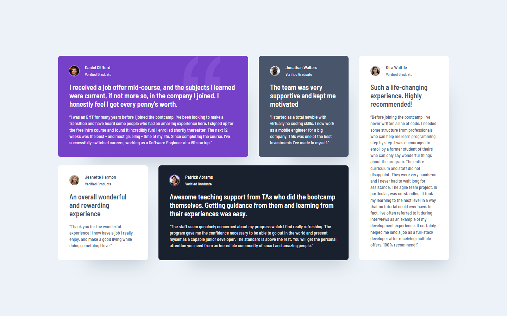

# Testimonials Grid Section

A responsive page presenting five coding bootcamp graduate testimonials. This
solution to the [Frontend Mentor challenge](https://www.frontendmentor.io/challenges/testimonials-grid-section-Nnw6J7Un7)
uses semantic HTML and Tailwind CSS.

## Overview

The page adapts from a single mobile column to a two-column tablet layout and a
four-column desktop grid. All five testimonials are shown in full, with one copy
of each card in the HTML.

### Desktop screenshot

Captured from the current local build at a **1440 × 900** viewport.



### Mobile screenshot

Captured from the same build at a **375 × 812** viewport using a full-page capture.
Cards follow the reading order Daniel, Jonathan, Jeanette, Patrick, Kira.


Both screenshots were taken in headless Chrome after the project font and all
portraits finished loading. They show the implemented page, rather than a design
reference.

## Links

- [Live demo on Netlify — earlier plain-CSS implementation](https://pettik-testimonials-grid-section.netlify.app/)
- [Source code — current Tailwind implementation](https://github.com/pettik/FrontendMentor--testimonials-grid-tailwind-css)
- [Frontend Mentor challenge](https://www.frontendmentor.io/challenges/testimonials-grid-section-Nnw6J7Un7)
- [Figma design](https://www.figma.com/design/9O03l3dpCgUQMIQqbPvuT8?fuid=1332602664592485491)

The Netlify URL was checked on **24 November 2026** and returned HTTP 200. It
currently serves the earlier plain-CSS version, so its appearance and markup
differ from this repository. The screenshots above show the current Tailwind
solution; redeploy this repository to update the public demo.

## My process

### Built with

- Semantic HTML: `main`, `article`, `header`, `blockquote`, and a logical heading hierarchy
- Tailwind CSS 3.4 with shared card styles in `@layer components`
- CSS Grid for page layout and Flexbox for author details
- Relative font sizes, flexible spacing, and breakpoints in `rem`
- Autoprefixer for browser prefixes in the generated stylesheet
- Barlow Semi Condensed from Google Fonts, with a sans-serif fallback

### Local development

Requires Node.js and npm. Install the locked dependencies and build the CSS:

```sh
npm ci
npm run build
```

Open `index.html` in a browser. No application server or runtime JavaScript is
required. To rebuild CSS automatically while editing:

```sh
npm run watch
```

Edit `index.html`, `input.css`, and `tailwind.config.js`. Rebuild and include
`css/style.css` when changing source styles or Tailwind classes. The generated
stylesheet is tracked so the repository can also be served directly as a static
site.

### Layout and accessibility decisions

The grid uses one column below `48rem`, two from `48rem`, and four from
`64rem`. On desktop, Daniel and Patrick span two columns and Kira spans two rows.
The desktop layout is applied only when there is enough space for four cards.

Tailwind's grid utilities generate flexible tracks:

```css
grid-template-columns: repeat(4, minmax(0, 1fr));
```

Cards use `min-width: 0`, wrapping text, and content-sized rows. There are no fixed
card heights or line clamps, so longer text and larger fonts can increase card
height without hiding content.

The DOM follows the mobile reading order. Each testimonial is a labelled article
with an `h2`; a visually hidden `h1` identifies the page. Portraits use `alt=""`
because the adjacent text names each graduate. The decorative quotation mark is
a CSS background and is not part of the reading order.

Shared card rules live in `input.css`. Palette, font family, maximum width, and
shadow are centralized in `tailwind.config.js`.

## What I learned

Moving a card visually does not change screen-reader order. Keeping one copy of
each testimonial in the intended mobile order avoids duplicate content and makes
the reading experience consistent when the layout stacks.

Responsive layout needs an intermediate state. Switching straight to four columns
around tablet widths leaves too little space for the text; a two-column layout
between `48rem` and `64rem` keeps the cards readable.

Flexible column widths also need flexible content. Combining `minmax(0, 1fr)`
with `min-width: 0`, text wrapping, and automatic row heights lets the layout
accommodate larger text without clipping the testimonials.

## Verification

- `npm run build` completes successfully.
- Headless Chrome checks passed at widths of 320, 375, 768, 800, 1024, and 1440 CSS pixels.
- All five cards remain present, with no horizontal page or card overflow.
- Additional checks passed with the root font size increased from 16px to 32px
  at viewport widths of 375 and 1440 pixels.
- The project font and portrait images loaded before the screenshots were captured.

Exact comparison with the Figma file, manual screen-reader navigation, and
browser zoom checks remain to be completed.

## Continued development

- Deploy this Tailwind version to the public demo and verify the deployed result.
- Complete manual screen-reader and browser zoom checks.
- Explore self-hosting the font so typography does not depend on Google Fonts.
- Keep the desktop and mobile screenshots current when the visual design changes.

## Repository workflow

See [Contributing](CONTRIBUTING.md) for focused commits, descriptive messages,
build checks, and screenshot updates. The tracked [`.gitignore`](.gitignore)
excludes dependencies, build output, logs, local environment files, and common
editor and operating-system files.

## Useful resources

- [Tailwind CSS: responsive design](https://v3.tailwindcss.com/docs/responsive-design)
  explains the mobile-first breakpoint utilities used by the grid.
- [MDN: grid-template-columns](https://developer.mozilla.org/en-US/docs/Web/CSS/Reference/Properties/grid-template-columns)
  documents track sizing and the `minmax()` function used to keep columns flexible.

## Credits and author

Design and testimonial assets are provided by
[Frontend Mentor](https://www.frontendmentor.io/). The original Tailwind course
implementation is from Brad Traversy's
[Tailwind CSS From Scratch](https://www.traversymedia.com/tailwind-css-course).

- GitHub: [Petr Bednarski](https://github.com/pettik)
- Frontend Mentor: [@pettik](https://www.frontendmentor.io/profile/pettik)
